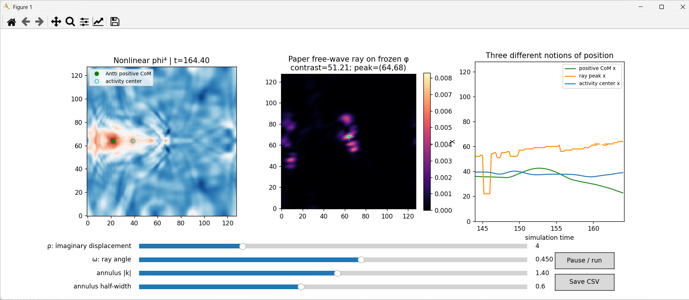

# Antti's Instanton 2 — a paper-first wave laboratory



**Research anchor:** OpenAI, [*Local smoothing for the Euclidean wave equation*](https://github.com/openai/math/blob/main/preprints/Local-smoothing-for-the-Euclidean-wave-equation-October-25-2026/paper.pdf) (October 25, 2026). This repository is an **experiment built from two explicit constructions in the manuscript**, not a proof of the manuscript and not evidence that its theorem already applies to a nonlinear particle.

## The question

Antti's original phi-four simulation has no separately evolving particle. Its green dot is the center of mass of \(\max(\phi,0)\). Does an apparent "jump" of that marker correspond to physical transport of a persistent field structure, or to redistribution and interference that shifts a weighted average?

The first instrument answers a smaller, testable question: **Does the paper's exactly specified imaginary null-ray continuation expose coherent wave focusing in a way our center-of-mass statistic misses?**

## The paper is the starting point

### I. Exact imaginary light-ray multiplier (Introduction §1.4; §2.1)

For a finite sum of positive-frequency Euclidean half-waves
\[
 u(t,x)=\sum_k c_k e^{i(k\cdot x-|k|t)},
\]
the analytic displacement \((t,x)\mapsto(t,x)-i\rho(1,\omega)\), \(|\omega|=1\), gives **exactly**
\[
 u_\rho(t,x;\omega)=\sum_k c_k
 e^{i(k\cdot x-|k|t)}
 \underbrace{e^{-\rho(|k|-k\cdot\omega)}}_{
 e^{-\rho|k|(1-\cos\Delta\theta)}}.
\]

This is not an arbitrary Gaussian filter. It is the explicit analytic continuation **from the paper's wave symbol**. Its angular width scales like \((\rho|k|)^{-1/2}\) for small angular separation. The executable uses FFT coefficients of a periodic free half-wave, a smooth frequency annulus and this exact multiplier. It **sums complex modes before squaring**, preserving interference. It also reports the phase-blind reference \(\sum|c_k|^2/N^4\), which equals the spatial mean of \(|u_\rho|^2\) by Parseval.

For synthetic waves this is genuinely a free half-wave calculation. For snapshots of the **nonlinear** substrate it is a *frozen instantaneous probe* applied to the snapshot's spectrum, **not** analytic continuation of the nonlinear solution or a conserved quantity.

### II. Appendix D's planar auxiliary Dirichlet operator, frozen on one fiber

In two spatial dimensions Appendix D, equation (D.1), Fourier-transforms in physical \(X\). On each spatial mode \(k\), the paper's auxiliary \(W\)-disk equation is
\[
 4|J|^2\Delta_W \widehat u-4|k\cdot e|^2\widehat u
 = \widehat\mu,\qquad u|_{\partial\mathbb D}=0.
\]

We implement **this very coefficient and sign pattern** as a finite-difference Dirichlet problem on an auxiliary disk with prescribed nonnegative source \(\mu(W)\), constant frozen \(J\), and constant \(k\cdot e\). The displayed energy is \(\int_\mathbb D(-u)\mu\,dW\). A positive source yields a nonpositive solution, as expected from the maximum principle.

**Scope boundary:** The paper's actual source \(\mu=A_{TT}\) comes from a positive, conserved, quaternionic lifted wave-current tensor; \(J\) and \(e\) depend on fiber geometry; and the proof uses cofactor conservation, boundary fluxes, and two auxiliary time circles. **This demo does not construct those objects, perform the full fiber solve, or establish local smoothing.** In particular, the auxiliary disk \(W\) must never be confused with the physical \((x,y)\) map. The synthetic source drawn on \(W\) is only a numerical verification of Appendix D's *frozen mode operator*.

### III. Original nonlinear field as the test bench

The physics is preserved from the original script:
\[
 \phi_{tt}=c^2\Delta\phi+a\phi-b\phi^3,\qquad a=b=0.1.
\]
No additional force, particle rule, or stabilizer is inserted.

The three distinguishable observers are (a) Antti's original positive-field CoM; (b) the location of the peak of the paper's **instantaneous spectral free-wave probe**; (c) the center of kinetic + gradient activity. We also record total nonnegative physical energy and compare it across time.

**Important:** The zero field in this potential is linearly unstable. A positive-field CoM is not a conserved energy centroid, and periodic boundaries make an ordinary Cartesian centroid misleading when activity crosses an edge. A CoM jump is not automatically a particle jump. A free Euclidean local-smoothing theorem cannot be transferred to this nonlinear, periodic system without additional work.

## Run

**Live physical field + adjustable paper-derived probe** (the closest experience to the original green-dot viewer):

~~~bash
python live_instanton.py
~~~

Move the rho, ray angle, annulus frequency and bandwidth sliders to see whether coherent concentration follows the original CoM or diverges from it. Use **Pause / run** and **Save CSV** in the interactive window. The right view is explicitly a frozen free-wave probe of the nonlinear snapshot, **not** the paper's lifted conserved current.


Python 3.10+:
```bash
python -m pip install -r requirements.txt

# Start HERE: paper-native free-wave calibration (engineered focus)
python paper_instanton.py --mode paper

# Apply the exact paper multiplier as an observer of Antti's original PDE
python paper_instanton.py --mode instanton --steps 1200

# GUI display in addition to saved results
python paper_instanton.py --mode instanton --steps 1200 --show

# See how rho and the ray direction change the angular cap
python paper_instanton.py --mode paper --rho 8 --angle 1.0
python -m pytest -q
```

Outputs in `results/`: `paper_instanton.png` (six-panel figure), `observations.csv` (timestamped measurements), `auxiliary_disk_u.csv` (verified frozen Appendix D solution). All plots can be generated headlessly.

## Honest controls and what would count as progress

1. **Single Fourier mode:** verify the analytic translation matches the exact multiplier mode-by-mode.
2. **Coherence:** compare waves with **identical Fourier magnitudes** and different phases, then check if a localized focus survives. This calibrates interference but is *expected from Fourier theory* and is **not a novelty claim**.
3. **Paper operator:** verify a positive source gives \(u\le0\), and increasing nonnegative screening decreases its magnitude.
4. **Nonlinear run:** compare focus-location history, energy/activity location, and original CoM. Repeat at several directions, times, seeds, and annuli. Check the apparent lead time against baseline local field energy, phase congruency, and a simple linear predictor on held-out sequences.
5. **Kill condition:** if the paper's ray observer fails to predict events better than matched ordinary controls, report a negative result; do not equate attractive images with physics.

**Unimplemented, and essential for a genuinely faithful full paper adaptation:** the continued first-order polarized field, its two-flow positive divergence-free tensor \(B\), the true \(\mu=A_{TT}\), the variable-coefficient fiber Dirichlet problem, and the two-circle propagation inequality. This repository implements **specific paper equations exactly in their stated restricted settings**, not all of the proof.

## Scientific status

Experimental numerical instrument. No claimed new particle, instanton solution, conserved current for the nonlinear model, or improved prediction of physical jumps. The OpenAI paper is the mathematical source; this repository tests whether the source's mechanisms are informative on Antti's model.

Original concept: Antti Luode. Paper: OpenAI (2026). See the license in this repository.


## The paper's conserved current — new reference experiment

The original live viewer is unchanged. The following programs are **a new, more faithful construction from the paper**, rather than just a directionally weighted FFT.

### What is implemented

**Lemma 2.1 (source current).** In a free wave's null coordinates, we construct
\[
B=\operatorname{Re}\sum_{\ell=1}^2 Z_\ell\otimes\overline{Z_\ell}
\]
at each lifted point \((t,x,s_0,w_{10},w_{11},w_{20},w_{21})\). The code checks positivity using eigenvalues and checks \(\sum_I\partial_I B_{IJ}=0\) by centered finite differences. Importantly, the coefficient vector fields use the **conjugated continued system field** as in Lemma 2.1. The actual conservation check caught and corrected an initial conjugation error.

**Proposition 2.2 (target wave density).** Rather than inventing a disk source, we use the paper's actual coherent time density from (2.15):
\[
\mu=A^0_{TT}=\left|\sum_{\kappa,v}b_0(W,v)m_{\kappa,v}u_{\kappa,v}\right|^2+
\left|\sum_{\kappa,v}b_1(W,v)m_{\kappa,v}u_{\kappa,v}\right|^2.
\]
For \(n=2\), \(W=w_a+kw_b\), \(Y\ne0\),
\(m_{\kappa,v}=(\kappa/|Y|)^{1/2}\exp[-\kappa|Y||W-v|^2/2]\),
\(b_0=(1+w_av/2)/\sqrt2\), and \(b_1=w_bv/(2\sqrt2)\).
The test suite verifies that the time density also equals the **pushforward of the source current**, using the paper's exact real Jacobian \(J=4|R|^4\) on a real chart.

**Appendix D, Eq. (D.1).** Fix \((T,\tau,\Phi)\). At each physical spatial Fourier mode \(k\), solve the planar **variable-coefficient** fiber problem
\[
[\Delta_W - |k\cdot e(W)|^2/|J(W)|^2]\widehat u
=\widehat\mu/(4|J(W)|^2),\qquad \widehat u|_{\partial\mathbb D}=0.
\]
Both \(e(W)\) and \(J(W)\) follow the actual chart:
\(Y=(\Phi+\sqrt2\tau)/(1+W^2/2)\),
\(J=(1+W^2/2)/(\sqrt2Y)\),
\(e=((1-W^2/2)/\sqrt2,-W)\).
The source \(\mu\) is the wave-derived \(A^0_{TT}\), evaluated at the same \(W\), not a hand-made Gaussian.

### How to run

```powershell
# Free-wave reference: equal spectral power, different phases.
# Compare genuine wave-derived auxiliary response, L4, and physical energy.
python lifted_current.py
# Faster diagnostic:
python lifted_current.py --n 12 --disk 9 --samples 3

# Original nonlinear field unchanged, with a per-snapshot
# positive-frequency free-wave projection from BOTH phi and phi_t:
python nonlinear_bridge.py
# Faster:
python nonlinear_bridge.py --steps 1200 --every 300
```

The first produces `results/paper_lifted/{time_series.csv,wave_and_disk.png,comparison_curves.png,comparison_metrics.json}`. The second produces `results/bridge/{nonlinear_reference.csv,nonlinear_paper_bridge.png}`. All figures and values are generated reproducibly by the script; no hand-authored data.

### What is and isn't claimed

- These are **genuine formulas from the paper** applied to an exact, finite superposition of *free* Euclidean half-waves, plus a finite-difference approximation to one fixed-\(\Phi\) auxiliary disk problem.
- The plotted \(\tfrac12\int(-u)\mu|J|^{-2}\,dW\,dX\) is a **single \(\Phi\) slice**, not the paper's full \(F_{\mathrm{pl}}\). We have not integrated the passive direction \(\Phi\), performed its cutoff/mollification, calculated parameter-time boundary fluxes, or proved its two-circle inequality.
- The bridge to Antti's nonlinear \(\phi^4\) **reconstructs a NEW FREE reference** at each snapshot from \(\phi\) **and** \(\phi_t\) using the positive-frequency formula. No claim of conservation across reconstructed snapshots, no nonlinear analytic continuation, and no theorem transferred to \(\phi^4\).
- Free-wave physical energy is a mandatory control. Ordinary \(\int |u|^4\), intensity contrast and an identical-spectrum phase-scramble arm are also reported. Phase sensitivity alone is already known; it is **not a discovery**.
- All reported concentration metrics depend on the chosen wave cap, auxiliary radius, aperture, and normalization. Establishing an incremental predictive advantage beyond simple wave L4 and phase-coherence controls remains **unproven**.


## Held-out discrimination benchmark: can the paper add predictive power?

```powershell
# 256 independently generated free waves, exact same modal power in every case
python heldout_discrimination.py

# Fast reproducibility check
python heldout_discrimination.py --cases 24 --bootstrap 100
```

This is the first properly held-out comparison, not a two-snapshot illustration. At physical time `T=0` the benchmark measures (a) the **actual Proposition 2.2 time density** sent through the **variable-coefficient Appendix D disk solver**, and (b) ordinary \(L^4\), intensity contrast, energy-flux RMS and peak, and two phase-locking statistics. There is **no nonlinear physics** in this particular benchmark; each realization is a known, free positive-frequency wave.

The waves share *identical spectral magnitudes and physical energy* but have independent phases. Four predeclared wave families include random phases, engineered future focus with phase jitter, engineered past focus, and mixed focus. Data are split by **independent wave realization**, not by frame. The benchmark uses the same fixed ridge regression and train-only standardization for baseline and baseline+paper models. The primary target is *future \(L^4\)*; the second target is future **peak/mean intensity contrast** at the same horizon. Paired bootstrap intervals are reported for the change in held-out squared error. A special control examines all pairs with nearly equal present \(L^4\) and compares their auxiliary response.

The disk solver caches numerical LU factors and is independently checked against the slower original Appendix D solver. The output includes:
- `results/heldout/heldout_metrics.json`: model scores, uncertainty intervals, pair statistics, negative-result verdict
- `results/heldout/independent_waves.csv`: phase-family label, ordinary features, paper feature, outcome and train/test split
- `results/heldout/paper_vs_L4.png`, `heldout_predictions.png`: visual comparisons

**Limits:** The paper's \(F_{\rm pl}\) integrates an entire spatial fiber with passive-coordinate cutoff, not just our fixed-\(\Phi\) slice. The benchmark measures the implemented slice and cannot claim all of the manuscript's proof machinery. Even a positive held-out gain would establish *incremental predictive value conditional on these selected baseline summaries*, not any information beyond the full wave state; an appropriately complete conventional observer has all the same input information. Forecasting actual nonlinear domain-wall behavior remains a separate task.

